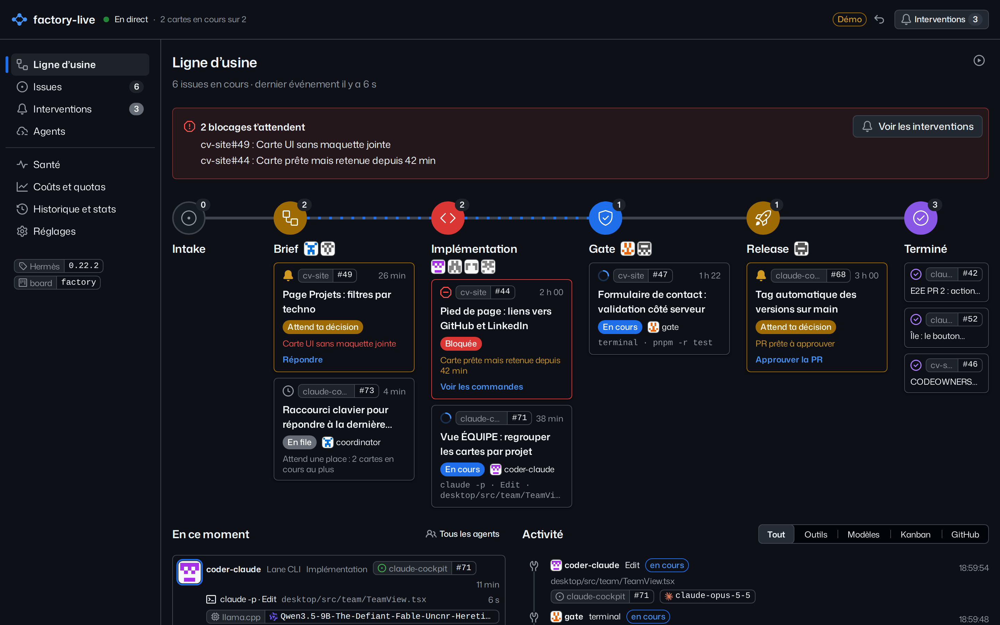
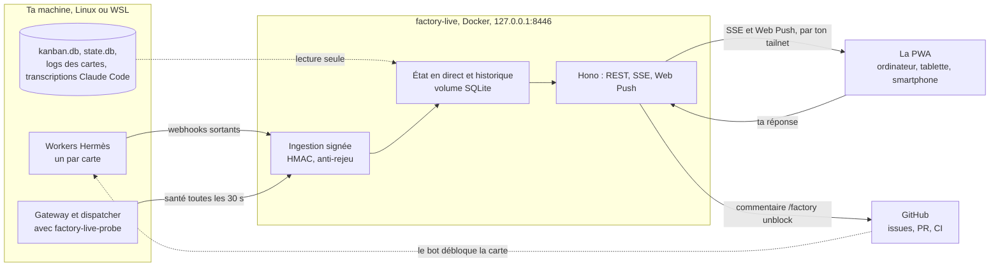

<div align="center">

# factory-live

**La factory Hermès en temps réel, et son déblocage depuis ton smartphone.**

[English](README.md) | Français

[![Site][site-badge]][site]
[![Démo][demo-badge]][demo]
[![Licence][license-badge]][license]
[![Conçu pour Hermès Agent][hermes-badge]][hermes]
[![Feuille de route][roadmap-badge]][roadmap]

[![CI][ci-badge]][ci]
[![E2E][e2e-badge]][ci]
[![Build du site][pages-badge]][pages]
[![Plateforme][platform-badge]][getting-started]

[![Node][node-badge]][development]
[![TypeScript][typescript-badge]][root-package]
[![React][react-badge]][web-package]
[![Primer React][primer-badge]][web-package]
[![Hono][hono-badge]][server-package]

[![Dernier commit][commit-badge]][commits]
[![Issues ouvertes][issues-badge]][issues]

</div>

<p align="center"></p>

[site-badge]: https://img.shields.io/badge/site-code--my--life.github.io-000000?style=flat
[site]: https://code-my-life.github.io/factory-live/fr/
[demo-badge]: https://img.shields.io/badge/d%C3%A9mo-dans%20ton%20navigateur-2ea44f?style=flat
[demo]: https://code-my-life.github.io/factory-live/demo/
[license-badge]: https://img.shields.io/badge/licence-MIT-blue?style=flat
[license]: LICENSE
[hermes-badge]: https://img.shields.io/badge/con%C3%A7u%20pour-Herm%C3%A8s%20Agent-1f6feb?style=flat
[hermes]: https://github.com/NousResearch/hermes-agent
[roadmap-badge]: https://img.shields.io/badge/feuille%20de%20route-sur%20le%20site-555555?style=flat
[roadmap]: https://code-my-life.github.io/factory-live/fr/#roadmap
[ci-badge]: https://img.shields.io/github/actions/workflow/status/code-my-life/factory-live/ci.yml?branch=main&label=CI&style=flat
[ci]: https://github.com/code-my-life/factory-live/actions/workflows/ci.yml
[e2e-badge]: https://img.shields.io/badge/e2e-Playwright%2C%20Chromium%20%7C%20WebKit-45ba4b?style=flat
[pages-badge]: https://img.shields.io/github/actions/workflow/status/code-my-life/factory-live/pages.yml?branch=main&label=site&style=flat
[pages]: https://github.com/code-my-life/factory-live/actions/workflows/pages.yml
[platform-badge]: https://img.shields.io/badge/tourne%20sur-Docker%20%7C%20Linux%20%7C%20WSL-2496ed?style=flat
[getting-started]: #démarrer
[node-badge]: https://img.shields.io/badge/node-%E2%89%A5%2024.15-339933?style=flat
[development]: #développement
[typescript-badge]: https://img.shields.io/github/package-json/dependency-version/code-my-life/factory-live/dev/typescript?style=flat
[root-package]: package.json
[react-badge]: https://img.shields.io/github/package-json/dependency-version/code-my-life/factory-live/react?filename=apps%2Fweb%2Fpackage.json&style=flat
[primer-badge]: https://img.shields.io/github/package-json/dependency-version/code-my-life/factory-live/@primer/react?filename=apps%2Fweb%2Fpackage.json&style=flat
[web-package]: apps/web/package.json
[hono-badge]: https://img.shields.io/github/package-json/dependency-version/code-my-life/factory-live/hono?filename=apps%2Fserver%2Fpackage.json&style=flat
[server-package]: apps/server/package.json
[commit-badge]: https://img.shields.io/github/last-commit/code-my-life/factory-live?style=flat
[commits]: https://github.com/code-my-life/factory-live/commits/main
[issues-badge]: https://img.shields.io/github/issues/code-my-life/factory-live?style=flat
[issues]: https://github.com/code-my-life/factory-live/issues

factory-live est la fenêtre d’une software factory autonome bâtie sur [Hermès Agent](https://github.com/NousResearch/hermes-agent). Les agents d’Hermès prennent les issues GitHub labellisées `factory` et les font avancer carte par carte sur une ligne d’usine : brief, implémentation, gate, release. factory-live montre cette ligne en direct : quelle issue est à quelle station, quel agent la tient, quel modèle a vraiment répondu, ce qu’il fait à la seconde près, et ce qui attend ta décision. Quand un agent bloque, tu réponds depuis l’app, sur ton ordinateur ou ton smartphone, et la carte repart.

Il tourne à côté de la factory, dans un seul conteneur Docker sur la même machine, et rejoint tes autres appareils par ton tailnet. Tout ce qu’il montre vient d’Hermès lui-même : ses webhooks natifs signés pour le direct, ses propres bases, en lecture seule, pour le reste. Rien n’est écrit pour lui.

factory-live est une **Progressive Web App** : elle s’installe depuis le navigateur, sans store, sur ordinateur (Chrome, Edge), sur Android (Chrome : « Installer l’application ») et sur iPhone ou iPad (Safari : Partager, « Sur l’écran d’accueil »). Installée, elle a son icône sur l’écran d’accueil, s’ouvre en plein écran, t’envoie une notification push pour les blocages qui t’attendent, et s’ouvre hors ligne sur le dernier état reçu. Sur iPhone et iPad, les notifications push ne marchent qu’une fois l’app installée (iOS 16.4 ou plus) ; sur Android, dès le navigateur.

L’interface est en français ; le code est en anglais. Le design suit [Primer](https://primer.style), le design system de GitHub. La [démo](https://code-my-life.github.io/factory-live/demo/) rejoue un après-midi de la factory dans ton navigateur, sans serveur.

## Ce que c’est, et pour qui

factory-live est fait pour un développeur qui fait tourner une factory d’agents d’IA et ne veut plus la suivre à travers un terminal, un dashboard, un bot de discussion et dix onglets GitHub. Il répond d’un coup d’œil à trois questions : où en est chaque issue, est-ce que quelque chose bloque, et combien ça coûte. Il regarde la factory sans jamais la piloter : sa seule écriture est le commentaire que tu demandes.

Il a été construit pour la factory de Code My Life, qui développe ses propres outils, factory-live compris. Si tu fais tourner Hermès Agent avec un kanban alimenté par des issues GitHub, il devrait s’adapter à ta factory avec quelques réglages (voir [Configuration](#configuration)).

## Ce qu’on y voit

- **La ligne d’usine.** Six stations : Intake, Brief, Implémentation, Gate, Release, Terminé. Une boîte par issue avec son état (en cours, attend ta décision, bloquée, en file), l’agent qui la tient et ce qu’il fait en ce moment ; la ligne coule vers les stations au travail et une boîte glisse quand son issue change de station. En dessous, ce que fait chaque agent et l’activité en direct, une entrée par appel d’outil, réponse de modèle ou événement du kanban.
- **Une issue et son graphe de cartes.** Les cartes de l’issue (brief, implémentation, release) dessinées comme la même ligne, les runs de chaque carte avec le modèle réellement servi, la transcription intégrale (session Hermès, lane Claude Code ou OpenCode, log brut du terminal), la PR et sa CI, les jetons et le coût.
- **Interventions et déblocage.** La question entière de l’agent, et une zone de réponse. Ta réponse est postée sur l’issue en `/factory unblock <réponse>`, à ton nom sur GitHub ; le bot de la factory réagit, la carte repart, et l’app suit chaque étape. Une carte retenue pour une autre raison vient avec les commandes exactes à copier. Les blocages qui t’attendent arrivent aussi sur ton smartphone en notification push, avec une pastille sur l’icône de l’app.
- **Agents et modèles.** Chaque agent avec son rôle, sa chaîne de modèles dans l’ordre des fallbacks, son effort, ses skills et ses plugins, les refus de ses gardes sur 7 jours, son taux de passage en gate et sa durée médiane de run, et la dérive entre la configuration en service et celle du dépôt.
- **Santé.** Gateway, dispatcher, pause, dashboard, fournisseurs de modèles (freellmapi, NVIDIA, llama.cpp et sa VRAM, Claude Code), serveurs MCP, API et webhooks GitHub, tâches cron, et les sources de factory-live lui-même.
- **Coûts et quotas.** Jetons, appels et réponses 429 par jour, par modèle et par agent, et le coût estimé des runs Claude, sur 24 heures, 7 ou 30 jours.
- **Historique et stats.** Issues terminées, délai médian du label au merge, blocages, ton temps de réponse médian, temps par station, passage en gate du premier coup pour chaque harnais et modèle, et les dernières issues terminées avec leur version.

L’en-tête dit toujours l’état du lien : en direct, connexion, hors ligne avec l’âge du dernier état reçu, factory en pause, ou factory muette.

## Comment ça marche



- **Webhooks sortants natifs, signés.** Le réglage `hooks.outbound` d’Hermès Agent poste chaque événement (appels d’outils, réponses de modèles, événements du kanban, sessions, skills, sous-agents) vers `/api/ingest/hermes`, signé HMAC-SHA256 avec un secret partagé. Hermès les envoie depuis une file bornée dans un thread démon : un agent n’est jamais ralenti, et rien n’est écrit sur disque pour factory-live. Les hooks qui transportent toute la conversation ne sont pas abonnés.
- **Une sonde de santé.** Le plugin `factory-live-probe` tourne dans le gateway, vérifie les services toutes les 30 secondes et poste un rapport signé vers `/api/ingest/health`. Après 90 secondes sans rapport, la sonde est dite muette.
- **Le kanban et les sessions, en lecture seule.** `kanban.db` (suivie par `PRAGMA data_version` toutes les 300 ms), la `state.db` de chaque agent, les logs des cartes et les transcriptions de Claude Code sont ouverts en lecture seule, par des requêtes courtes ; une règle de lint interdit toute écriture dans les adaptateurs Hermès. Après un redémarrage, factory-live s’y recale. La base d’OpenCode porte des jetons OAuth : elle n’est jamais montée.
- **Un seul flux pour tous les écrans.** Le serveur tient l’état en direct et envoie chaque changement par Server-Sent Events. Un `ping` après 15 secondes de silence garde le lien honnête ; un flux muet 45 secondes est relancé, et l’app dit quand elle est hors ligne.
- **Une Progressive Web App.** Installée depuis le navigateur, sans store, sur ordinateur, Android, iPhone ou iPad ; un service worker garde la coque disponible hors ligne, et l’app s’ouvre sur le dernier état reçu, gardé sur l’appareil. L’API ne passe jamais par le cache.
- **Push.** Web Push avec des clés VAPID générées au premier démarrage, seulement pour les blocages qui t’attendent. Le contact envoyé aux services de push est l’adresse du dépôt, jamais un e-mail.
- **Déblocage.** Une GitHub App dédiée, créée en un clic depuis factory-live, lit issues, PR et CI avec son jeton d’installation ; le commentaire part avec ton jeton utilisateur, et le bot de la factory le prend donc pour le tien.

Le code suit une clean architecture vérifiée en CI : règles pures dans `packages/domain`, contrats zod dans `packages/contracts`, cas d’usage derrière des ports dans `apps/server/src/application`, adaptateurs et HTTP autour, et la PWA dans `apps/web`. Le détail : [docs/ARCHITECTURE.md](docs/ARCHITECTURE.md) et [docs/decisions/](docs/decisions/).

Si factory-live s’arrête, la factory ne le remarque pas : les envois échouent sans bloquer aucun agent, et factory-live se recale sur les bases à son redémarrage.

## Démarrer

Il te faut Linux ou WSL avec Docker, Hermès Agent avec un kanban, Tailscale pour tes autres appareils, et un compte GitHub.

### 1. Côté Hermès

Chaque agent déclare factory-live dans ses hooks sortants, avec les événements à envoyer :

```yaml
hooks:
  outbound:
    - name: factory-live
      url: http://127.0.0.1:8446/api/ingest/hermes
      secret_env: FACTORY_LIVE_HOOK_SECRET
      timeout: 2
      events: [pre_tool_call, post_tool_call, post_api_request, api_request_error, on_session_end]
```

Le secret est une valeur aléatoire dans `~/.hermes/.env` (`FACTORY_LIVE_HOOK_SECRET`), copiée dans `~/.config/factory-live/hook-secret` en mode 600. Le plugin `factory-live-probe` tourne dans le gateway. Dans la factory de Code My Life, son installateur fait ces trois étapes.

### 2. Le conteneur

```bash
cp docker/.env.example docker/.env      # puis pose tes valeurs, voir Configuration
docker compose -f docker/compose.yaml up -d --build
docker ps --filter name=factory-live    # healthy
```

L’app est alors sur `http://localhost:8446` depuis cette machine.

### 3. Ton tailnet

```bash
tailscale serve --bg --https=8446 http://127.0.0.1:8446
```

Tes autres appareils joignent l’app sur `https://<machine>.<tailnet>.ts.net:8446`, en HTTPS, ce qu’exige son installation. Le tailnet seulement, jamais Funnel.

### 4. Tes appareils

factory-live est une Progressive Web App : elle s’installe depuis le navigateur, sans store.

| Appareil                           | Installer                                                                                                                                                                                                    | Notifications                                                                                                                                      |
| ---------------------------------- | ------------------------------------------------------------------------------------------------------------------------------------------------------------------------------------------------------------ | -------------------------------------------------------------------------------------------------------------------------------------------------- |
| Ordinateur (Windows, macOS, Linux) | Chrome ou Edge : `http://localhost:8446` sur cette machine, l’adresse du tailnet ailleurs, puis l’icône d’installation de la barre d’adresse. Sur le Mac, Safari marche aussi : Fichier, « Ajouter au Dock » | Dans les réglages de l’app, « Activer les notifications », puis « Envoyer un test » ; Windows doit autoriser les notifications de Chrome ou d’Edge |
| Android                            | Chrome : l’adresse du tailnet, puis le menu, « Installer l’application »                                                                                                                                     | Idem, dans l’app installée ou dans le navigateur                                                                                                   |
| iPhone, iPad                       | Safari : l’adresse du tailnet, puis Partager, « Sur l’écran d’accueil », et ouvrir factory-live depuis l’écran d’accueil                                                                                     | Idem, seulement dans l’app installée (iOS 16.4 ou plus)                                                                                            |

### 5. GitHub

Ouvre `http://localhost:8446/api/github/setup` et confirme sur GitHub : factory-live crée une GitHub App privée, sans webhook, que tu installes sur tes dépôts. Puis, dans les réglages de l’app, « Se connecter à GitHub » : tes réponses partent alors à ton nom. D’ici là, un jeton fine-grained dans `~/.config/factory-live/github-token` sert de repli.

### Configuration

Les variables de `docker/compose.yaml`, posées dans `docker/.env` :

| Variable           | Rôle                                                                                           |
| ------------------ | ---------------------------------------------------------------------------------------------- |
| `PUBLIC_ORIGINS`   | Les adresses de l’app : `http://localhost:8446,https://<machine>.<tailnet>.ts.net:8446`        |
| `TAILSCALE_LOGINS` | Les logins Tailscale autorisés à écrire depuis un autre appareil, par exemple `<login>@github` |
| `HERMES_BOARD`     | Le kanban de la factory (`factory`)                                                            |
| `GITHUB_OWNER`     | L’organisation ou le compte GitHub de la factory                                               |
| `FACTORY_REPO`     | Le dépôt de la factory, lu pour sa configuration (dérive)                                      |
| `DASHBOARD_URL`    | L’adresse du dashboard Hermès, liée depuis l’app                                               |
| `LOG_LEVEL`        | `info` par défaut                                                                              |

Les valeurs par défaut visent la factory de Code My Life ; le login GitHub autorisé à débloquer se règle dans `apps/server/src/config.ts`. Exploitation, montages, secrets et pannes : [docs/RUNBOOK.md](docs/RUNBOOK.md).

## Développement

Node.js 24.15 ou plus.

```bash
npm ci
npm run dev:web       # l’app sur les données de démo, http://127.0.0.1:5173
npm run dev:server    # le serveur sur ton ~/.hermes, en lecture seule, port 8446
npm run verify        # format, lint (ESLint, Stylelint avec les règles de Primer), types, texte, architecture, tests, build
npm run e2e           # Playwright : la démo sur écrans d’ordinateur et de smartphone, l’app live sur un faux serveur d’API
```

- **Mode démo.** `VITE_DATA_SOURCE=demo`, par défaut en développement et pour les tests de bout en bout, rejoue un scénario réaliste de la factory sans serveur (`apps/web/src/demo/`) ; `live` branche l’app sur l’API. Le site publie la même démo.
- **Tests de bout en bout.** Chromium en local ; WebKit (le moteur de Safari) et les captures de référence tournent dans l’image officielle de Playwright, comme en CI. La commande est dans [docs/RUNBOOK.md](docs/RUNBOOK.md).
- **Le site.** `npm run site:build` construit les pages et la démo dans `site/dist`, `npm run site:preview` les sert sur `http://127.0.0.1:4195/factory-live/`, `npm run site:test` les vérifie, et `npm run site:captures` refait les captures.
- **Règles.** Le test d’abord, un mot par concept à l’écran, composants et jetons de Primer, aucune écriture dans Hermès : [AGENTS.md](AGENTS.md).

La CI lance `npm run verify` sur Node 24 et 26, construit et démarre l’image Docker, et lance les tests de bout en bout sous Chromium et WebKit. Le site a son propre workflow, qui le construit et le teste à chaque pull request et le déploie depuis `main`.

## Sécurité

- **Lecture seule.** Les bases d’Hermès sont ouvertes en lecture seule et jamais écrites ; la base d’OpenCode et ses jetons ne sont jamais montés.
- **Entrées signées.** Webhooks et rapports de la sonde sont signés HMAC-SHA256 et vérifiés contre une fenêtre d’anti-rejeu : un envoi non signé ou hors fenêtre est refusé, un doublon n’est jamais appliqué deux fois.
- **Une seule écriture.** Le commentaire `/factory unblock`, posté à ton nom sur GitHub, seulement depuis cette machine ou depuis le login Tailscale autorisé, avec contrôle de l’origine et 30 écritures par minute au plus.
- **Exposition.** Le conteneur écoute sur `127.0.0.1:8446` ; les autres appareils le joignent par ton tailnet avec `tailscale serve`, jamais Funnel. Pas de mot de passe : le tailnet est la frontière.
- **Conteneur.** Utilisateur 1000:1000, système de fichiers racine en lecture seule, aucune capacité.
- **Secrets.** Les clés de la GitHub App et tes jetons vivent dans la base du volume de données (mode 600), jamais dans le dépôt, les journaux ou l’API.

Signale une faille en privé, par une alerte de sécurité GitHub (security advisory), plutôt que dans une issue publique.

## Licence

[MIT](LICENSE).
