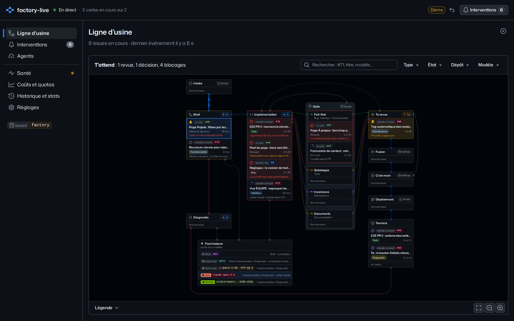
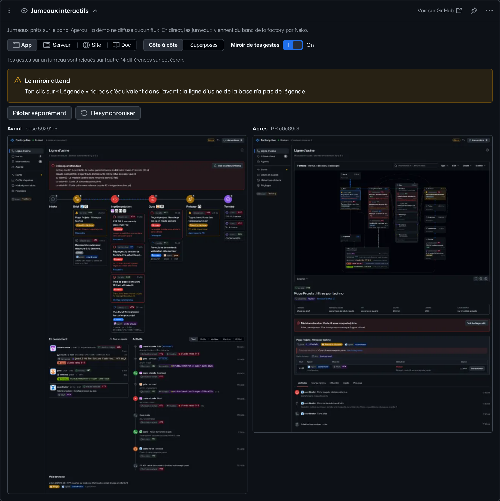
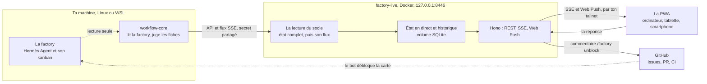

<div align="center">

# factory-live

**La factory Hermès en temps réel, et son déblocage depuis ton smartphone.**

[English](README.md) | Français

[![Site][site-badge]][site]
[![Démo][demo-badge]][demo]
[![Licence][license-badge]][license]
[![Conçu pour Hermès Agent][hermes-badge]][hermes]
[![Feuille de route][roadmap-badge]][roadmap]

[![CI][ci-badge]][ci]
[![E2E][e2e-badge]][ci]
[![Build du site][pages-badge]][pages]
[![Plateforme][platform-badge]][getting-started]

[![Node][node-badge]][development]
[![TypeScript][typescript-badge]][root-package]
[![React][react-badge]][web-package]
[![Primer React][primer-badge]][web-package]
[![Hono][hono-badge]][server-package]

[![Dernier commit][commit-badge]][commits]
[![Issues ouvertes][issues-badge]][issues]

</div>

<p align="center"></p>

[site-badge]: https://img.shields.io/badge/site-code--my--life.github.io-000000?style=flat
[site]: https://code-my-life.github.io/factory-live/fr/
[demo-badge]: https://img.shields.io/badge/d%C3%A9mo-dans%20ton%20navigateur-2ea44f?style=flat
[demo]: https://code-my-life.github.io/factory-live/demo/
[license-badge]: https://img.shields.io/badge/licence-MIT-blue?style=flat
[license]: LICENSE
[hermes-badge]: https://img.shields.io/badge/con%C3%A7u%20pour-Herm%C3%A8s%20Agent-1f6feb?style=flat
[hermes]: https://github.com/NousResearch/hermes-agent
[roadmap-badge]: https://img.shields.io/badge/feuille%20de%20route-sur%20le%20site-555555?style=flat
[roadmap]: https://code-my-life.github.io/factory-live/fr/#roadmap
[ci-badge]: https://img.shields.io/github/actions/workflow/status/code-my-life/factory-live/ci.yml?branch=main&label=CI&style=flat
[ci]: https://github.com/code-my-life/factory-live/actions/workflows/ci.yml
[e2e-badge]: https://img.shields.io/badge/e2e-Playwright%2C%20Chromium%20%7C%20WebKit-45ba4b?style=flat
[pages-badge]: https://img.shields.io/github/actions/workflow/status/code-my-life/factory-live/pages.yml?branch=main&label=site&style=flat
[pages]: https://github.com/code-my-life/factory-live/actions/workflows/pages.yml
[platform-badge]: https://img.shields.io/badge/tourne%20sur-Docker%20%7C%20Linux%20%7C%20WSL-2496ed?style=flat
[getting-started]: #démarrer
[node-badge]: https://img.shields.io/badge/node-%E2%89%A5%2024.15-339933?style=flat
[development]: #développement
[typescript-badge]: https://img.shields.io/github/package-json/dependency-version/code-my-life/factory-live/dev/typescript?style=flat
[root-package]: package.json
[react-badge]: https://img.shields.io/github/package-json/dependency-version/code-my-life/factory-live/react?filename=apps%2Fweb%2Fpackage.json&style=flat
[primer-badge]: https://img.shields.io/github/package-json/dependency-version/code-my-life/factory-live/@primer/react?filename=apps%2Fweb%2Fpackage.json&style=flat
[web-package]: apps/web/package.json
[hono-badge]: https://img.shields.io/github/package-json/dependency-version/code-my-life/factory-live/hono?filename=apps%2Fserver%2Fpackage.json&style=flat
[server-package]: apps/server/package.json
[commit-badge]: https://img.shields.io/github/last-commit/code-my-life/factory-live?style=flat
[commits]: https://github.com/code-my-life/factory-live/commits/main
[issues-badge]: https://img.shields.io/github/issues/code-my-life/factory-live?style=flat
[issues]: https://github.com/code-my-life/factory-live/issues

factory-live est la fenêtre d’une software factory autonome bâtie sur [Hermès Agent](https://github.com/NousResearch/hermes-agent). Les agents d’Hermès prennent les issues GitHub labellisées `factory` et les font avancer carte par carte sur une ligne d’usine : brief, implémentation, gate, release. factory-live montre cette ligne en direct : quelle issue est à quelle station, quel agent la tient, quel modèle a vraiment répondu, ce qu’il fait à la seconde près, et ce qui attend ta décision. Quand un agent bloque, tu réponds depuis l’app, sur ton ordinateur ou ton smartphone, et la carte repart.

Il tourne à côté de la factory, dans un seul conteneur Docker sur la même machine, et rejoint tes autres appareils par ton tailnet. Tout ce qu’il montre vient de l’API de [workflow-core](https://github.com/code-my-life/workflow-core), le socle commun des workflows, qui lit les tableaux d’Hermès en lecture seule et pousse chaque changement par un flux, et de GitHub. Rien n’est écrit pour lui.

factory-live est une **Progressive Web App** : elle s’installe depuis le navigateur, sans store, sur ordinateur (Chrome, Edge), sur Android (Chrome : « Installer l’application ») et sur iPhone ou iPad (Safari : Partager, « Sur l’écran d’accueil »). Installée, elle a son icône sur l’écran d’accueil, s’ouvre en plein écran, t’envoie une notification push pour les blocages qui t’attendent, et s’ouvre hors ligne sur le dernier état reçu. Sur iPhone et iPad, les notifications push ne marchent qu’une fois l’app installée (iOS 16.4 ou plus) ; sur Android, dès le navigateur.

L’interface est en français ; le code est en anglais. Le design suit [Primer](https://primer.style), le design system de GitHub. La [démo](https://code-my-life.github.io/factory-live/demo/) rejoue un après-midi de la factory dans ton navigateur, sans serveur.

## Ce que c’est, et pour qui

factory-live est fait pour un développeur qui fait tourner une factory d’agents d’IA et ne veut plus la suivre à travers un terminal, un dashboard, un bot de discussion et dix onglets GitHub. Il répond d’un coup d’œil à trois questions : où en est chaque issue, est-ce que quelque chose bloque, et combien ça coûte. Il n’écrit que ce que tu demandes, en ton nom : un geste comme `/factory unblock`, ou une issue qu’il ouvre pour toi.

Il a été construit pour la factory de Code My Life, qui développe ses propres outils, factory-live compris. Si tu fais tourner Hermès Agent avec un kanban alimenté par des issues GitHub, il devrait s’adapter à ta factory avec quelques réglages (voir [Configuration](#configuration)).

## Les jumeaux vivants : teste la PR, pas son diff

Quand des agents écrivent le code, lire un diff ne dit plus si une pull request fait ce que tu as demandé. Alors sous chaque issue, factory-live montre la recette de sa pull request, et en son cœur, **les jumeaux vivants** : l’app telle qu’elle était avant la pull request et telle qu’elle est après, toutes deux en marche, côte à côte. Tu cliques, tu tapes, tu fais défiler sur l’une, et le même geste est rejoué sur l’autre. Tu vois ce que la pull request change en t’en servant, sans récupérer la branche ni rien lancer chez toi.

<p align="center"></p>

- **Deux apps vivantes.** La base et la tête de la pull request, chacune dans son navigateur sur le banc de jumeaux de la factory, diffusées en direct dans la recette : côte à côte, superposées avec un curseur, ou l’une après l’autre sur smartphone.
- **Un miroir de tes gestes.** Pointeur, clics, molette, clavier, toucher : ce que tu fais sur un jumeau, l’autre le fait aussi.
- **La différence, sous ton doigt.** Quand les deux écrans diffèrent là où tu cliques, le miroir s’arrête et te le dit : c’est là que la pull request change quelque chose. Tu pilotes alors chaque jumeau séparément, ou tu les ramènes tous deux à l’accueil.
- **Rien à installer.** La factory démarre les jumeaux quand la gate de la pull request est verte, et les arrête à la fusion. Sans Internet ni secret, chacun ne voit que son app. Sur ton PC comme sur ton iPhone, par ton tailnet.

Autour d’eux, la recette donne le reste des preuves, ci-dessous.

## Ce qu’on y voit

- **La ligne d’usine.** Un seul graphe de toute la factory : Intake, Brief, Implémentation, la gate et ses quatre preuves selon le type d’issue (fail-first, sabotages, invariance, documents), ta revue, Fusion, la CI de main, Déploiement et Terminé, avec la branche Diagnostic, les retours (gate rouge, changements demandés, revert) et les fournisseurs de modèles qui alimentent les stations où un agent appelle un modèle. Une ligne par issue avec son état (en cours, attend ta décision, bloquée, en file), l’agent qui la tient et le modèle qu’il appelle. Une issue qui avance voyage le long des liens jusqu’à sa nouvelle station ; les liens sans trafic s’effacent. Une recherche rapide et des filtres par type, état, dépôt et modèle ; toute la factory tient à l’écran d’abord, et se zoome à deux doigts ou avec Ctrl et la molette.
- **Une issue et son trajet.** Touche une issue : les stations qu’elle a traversées s’allument comme des données qui courent sur les liens, et sous le graphe s’ouvrent les runs de sa carte au travail avec le modèle réellement servi, la transcription intégrale (session Hermès, lane Claude Code ou OpenCode, log brut du terminal), la pull request et sa CI, les jetons et le coût.
- **La recette d’une pull request.** Plus de diff à lire : sous son issue, les preuves que la pull request fait ce qui était demandé. Chaque critère d’acceptation de l’issue avec son verdict, jugé par les tests que la pull request nomme dans les rapports JUnit de sa tête, par une règle écrite et sans modèle ; les checks de la tête, la gate règle par règle, les suites de tests avec ce qui a échoué, les preuves textuelles et les captures avant et après, les fils de revue. Six widgets que tu réordonnes, épingles, replies ou mets côte à côte, la disposition gardée par type d’écran.
- **Les jumeaux vivants.** L’app avant et après la pull request, toutes deux en marche dans sa recette, tes gestes rejoués de l’une sur l’autre (voir [Les jumeaux vivants](#les-jumeaux-vivants--teste-la-pr-pas-son-diff)).
- **Interventions et déblocage.** La question entière de l’agent, et une zone de réponse. Ta réponse est postée sur l’issue en `/factory unblock <réponse>`, à ton nom sur GitHub ; le bot de la factory réagit, la carte repart, et l’app suit chaque étape. Une carte retenue pour une autre raison vient avec les commandes exactes à copier. Les blocages qui t’attendent arrivent aussi sur ton smartphone en notification push, avec une pastille sur l’icône de l’app.
- **Agents et modèles.** Chaque agent avec son rôle, sa chaîne de modèles dans l’ordre des fallbacks, son effort, ses skills et ses plugins, les refus de ses gardes sur 7 jours, son taux de passage en gate et sa durée médiane de run, et la dérive entre la configuration en service et celle du dépôt.
- **Santé.** Gateway, dispatcher, pause, dashboard, fournisseurs de modèles (freellmapi, NVIDIA, llama.cpp et sa VRAM, Claude Code), serveurs MCP, API et webhooks GitHub, tâches cron, et workflow-core, la source de factory-live.
- **Coûts et quotas.** Jetons, appels et réponses 429 par jour, par modèle et par agent, et le coût estimé des runs Claude, sur 24 heures, 7 ou 30 jours.
- **Historique et stats.** Issues terminées, délai médian du label au merge, blocages, ton temps de réponse médian, temps par station, passage en gate du premier coup pour chaque harnais et modèle, et les dernières issues terminées avec leur version.

L’en-tête dit toujours l’état du lien : en direct, connexion, hors ligne avec l’âge du dernier état reçu, factory en pause, ou factory muette.

## Comment ça marche



- **La factory, par workflow-core, et rien d’autre.** Les tableaux, leurs cartes et leurs runs, les fiches des workflows, les agents au travail, l’activité, les coûts, les interventions avec le diagnostic d’un blocage et l’état de la machine viennent de l’API HTTP de workflow-core et de son flux Server-Sent Events, derrière un secret partagé. Chaque événement porte l’état complet de la carte et un curseur ; après un redémarrage, factory-live reprend au curseur, et un `reset` lui fait relire tout l’état. workflow-core ouvre les bases de la factory en lecture seule ; factory-live n’en monte aucune, ni le dépôt de la factory, ni aucune transcription.
- **Les fiches que juge le socle.** La ligne du code et le studio se dessinent depuis les fiches que workflow-core sert et juge. Aucune n’est embarquée dans l’app : avant la première, la ligne dit qu’elle l’attend ; quand le socle ne répond plus, la dernière reste.
- **Un seul flux pour tous les écrans.** Le serveur tient l’état en direct et envoie chaque changement par Server-Sent Events. Un `ping` après 15 secondes de silence garde le lien honnête ; un flux muet 45 secondes est relancé, et l’app dit quand elle est hors ligne.
- **Une Progressive Web App.** Installée depuis le navigateur, sans store, sur ordinateur, Android, iPhone ou iPad ; un service worker garde la coque disponible hors ligne, et l’app s’ouvre sur le dernier état reçu, gardé sur l’appareil. L’API ne passe jamais par le cache.
- **Push.** Web Push avec des clés VAPID générées au premier démarrage, seulement pour les blocages qui t’attendent. Le contact envoyé aux services de push est l’adresse du dépôt, jamais un e-mail.
- **Le banc de jumeaux.** La factory fait tourner chaque paire de jumeaux dans Docker, sur des réseaux internes sans Internet, chaque app dans un Chromium Neko diffusé en WebRTC, derrière un miroir qui rejoue les gestes d’un jumeau sur l’autre. factory-live ne lance aucun conteneur : il lit l’état de la paire dans workflow-core, demande au miroir une session de spectateur pour chaque jumeau (aucun mot de passe n’arrive à factory-live) et relaie tes gestes au miroir, derrière la même garde que le déblocage.
- **Déblocage.** Une GitHub App dédiée, créée en un clic depuis factory-live, lit issues, PR et CI avec son jeton d’installation ; le commentaire part avec ton jeton utilisateur, et le bot de la factory le prend donc pour le tien.

Le code suit une clean architecture vérifiée en CI : règles pures dans `packages/domain`, contrats zod dans `packages/contracts`, cas d’usage derrière des ports dans `apps/server/src/application`, adaptateurs et HTTP autour, et la PWA dans `apps/web`. Le détail : [docs/ARCHITECTURE.md](docs/ARCHITECTURE.md) et [docs/decisions/](docs/decisions/).

Si factory-live s’arrête, ni la factory ni workflow-core ne le remarquent : factory-live relit tout l’état du socle à son redémarrage.

## Démarrer

Il te faut Linux ou WSL avec Docker, Hermès Agent avec un kanban lu par workflow-core, Tailscale pour tes autres appareils, et un compte GitHub.

### 1. workflow-core

factory-live lit la factory par workflow-core (`code-my-life/workflow-core`), sur cette machine au port 8447. Copie son secret partagé (`WORKFLOW_CORE_SECRET` de `~/.config/workflow-core/.env`) dans `~/.config/factory-live/workflow-core-secret`, sans retour à la ligne, en mode 600. Sans son adresse ou son secret, factory-live s’arrête au démarrage en nommant ce qui manque.

### 2. Le conteneur

```bash
cp docker/.env.example docker/.env      # puis pose tes valeurs, voir Configuration
docker compose -f docker/compose.yaml up -d --build
docker ps --filter name=factory-live    # healthy
```

L’app est alors sur `http://localhost:8446` depuis cette machine.

### 3. Ton tailnet

```bash
tailscale serve --bg --https=8446 http://127.0.0.1:8446
```

Tes autres appareils joignent l’app sur `https://<machine>.<tailnet>.ts.net:8446`, en HTTPS, ce qu’exige son installation. Le tailnet seulement, jamais Funnel.

### 4. Tes appareils

factory-live est une Progressive Web App : elle s’installe depuis le navigateur, sans store.

| Appareil                           | Installer                                                                                                                                                                                                    | Notifications                                                                                                                                      |
| ---------------------------------- | ------------------------------------------------------------------------------------------------------------------------------------------------------------------------------------------------------------ | -------------------------------------------------------------------------------------------------------------------------------------------------- |
| Ordinateur (Windows, macOS, Linux) | Chrome ou Edge : `http://localhost:8446` sur cette machine, l’adresse du tailnet ailleurs, puis l’icône d’installation de la barre d’adresse. Sur le Mac, Safari marche aussi : Fichier, « Ajouter au Dock » | Dans les réglages de l’app, « Activer les notifications », puis « Envoyer un test » ; Windows doit autoriser les notifications de Chrome ou d’Edge |
| Android                            | Chrome : l’adresse du tailnet, puis le menu, « Installer l’application »                                                                                                                                     | Idem, dans l’app installée ou dans le navigateur                                                                                                   |
| iPhone, iPad                       | Safari : l’adresse du tailnet, puis Partager, « Sur l’écran d’accueil », et ouvrir factory-live depuis l’écran d’accueil                                                                                     | Idem, seulement dans l’app installée (iOS 16.4 ou plus)                                                                                            |

### 5. GitHub

Ouvre `http://localhost:8446/api/github/setup` et confirme sur GitHub : factory-live crée une GitHub App privée, sans webhook, que tu installes sur tes dépôts. Puis, dans les réglages de l’app, « Se connecter à GitHub » : tes réponses partent alors à ton nom. D’ici là, un jeton fine-grained dans `~/.config/factory-live/github-token` sert de repli.

### Configuration

Les variables de `docker/compose.yaml`, posées dans `docker/.env` :

| Variable            | Rôle                                                                                                      |
| ------------------- | --------------------------------------------------------------------------------------------------------- |
| `PUBLIC_ORIGINS`    | Les adresses de l’app : `http://localhost:8446,https://<machine>.<tailnet>.ts.net:8446`                   |
| `TAILSCALE_LOGINS`  | Les logins Tailscale autorisés à écrire depuis un autre appareil, par exemple `<login>@github`            |
| `GITHUB_OWNER`      | L’organisation ou le compte GitHub de la factory                                                          |
| `WORKFLOW_CORE_URL` | L’adresse de workflow-core vue du conteneur (`http://host.docker.internal:8447`)                          |
| `WORKFLOWS`         | Les workflows suivis par leur propre API, pour leurs éléments (`studio=http://host.docker.internal:8448`) |
| `DASHBOARD_URL`     | L’adresse du dashboard de la factory, liée depuis l’app                                                   |
| `LOG_LEVEL`         | `info` par défaut                                                                                         |

Les valeurs par défaut visent la factory de Code My Life ; le login GitHub autorisé à débloquer se règle dans `apps/server/src/config.ts`. Son secret est `~/.config/factory-live/workflow-core-secret`. Exploitation, montages, secrets et pannes : [docs/RUNBOOK.md](docs/RUNBOOK.md).

## Développement

Node.js 24.15 ou plus.

```bash
npm ci
npm run dev:web       # l’app sur les données de démo, http://127.0.0.1:5173
npm run dev:server    # le serveur sur workflow-core (WORKFLOW_CORE_URL et workflow-core-secret requis), port 8446
npm run verify        # format, lint (ESLint, Stylelint avec les règles de Primer), types, texte, architecture, tests, build
npm run e2e           # Playwright : la démo sur écrans d’ordinateur et de smartphone, l’app live sur un faux serveur d’API
```

- **Mode démo.** `VITE_DATA_SOURCE=demo`, par défaut en développement et pour les tests de bout en bout, rejoue un scénario réaliste de la factory sans serveur (`apps/web/src/demo/`) ; `live` branche l’app sur l’API. Le site publie la même démo.
- **Tests de bout en bout.** Chromium en local ; WebKit (le moteur de Safari) et les captures de référence tournent dans l’image officielle de Playwright, comme en CI. La commande est dans [docs/RUNBOOK.md](docs/RUNBOOK.md).
- **Le site.** `npm run site:build` construit les pages et la démo dans `site/dist`, `npm run site:preview` les sert sur `http://127.0.0.1:4195/factory-live/`, `npm run site:test` les vérifie, et `npm run site:captures` refait les captures.
- **Règles.** Le test d’abord, un mot par concept à l’écran, composants et jetons de Primer, la factory lue par workflow-core seul : [AGENTS.md](AGENTS.md).

La CI lance `npm run verify` sur Node 24 et 26, construit et démarre l’image Docker, et lance les tests de bout en bout sous Chromium et WebKit. Le site a son propre workflow, qui le construit et le teste à chaque pull request et le déploie depuis `main`.

## Sécurité

- **La factory lue par workflow-core seul.** Rien de la factory n’est monté dans le conteneur : ses bases, son dépôt et les transcriptions restent dehors ; workflow-core se lit par HTTP, derrière un secret partagé.
- **Une seule écriture.** Le commentaire `/factory unblock`, posté à ton nom sur GitHub, seulement depuis cette machine ou depuis le login Tailscale autorisé, avec contrôle de l’origine et 30 écritures par minute au plus.
- **Exposition.** Le conteneur écoute sur `127.0.0.1:8446` ; les autres appareils le joignent par ton tailnet avec `tailscale serve`, jamais Funnel. Pas de mot de passe : le tailnet est la frontière.
- **Conteneur.** Utilisateur 1000:1000, système de fichiers racine en lecture seule, aucune capacité.
- **Secrets.** Les clés de la GitHub App et tes jetons vivent dans la base du volume de données (mode 600), jamais dans le dépôt, les journaux ou l’API.

Signale une faille en privé, par une alerte de sécurité GitHub (security advisory), plutôt que dans une issue publique.

## Licence

[MIT](LICENSE).
