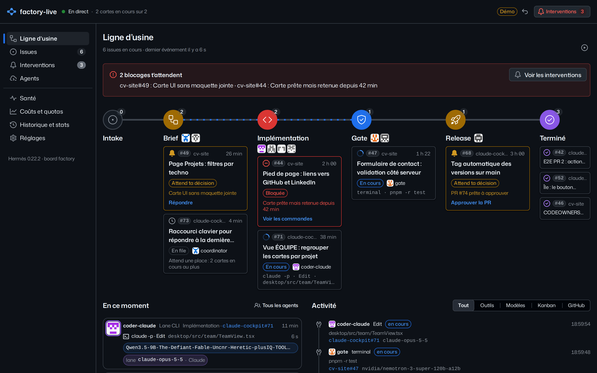
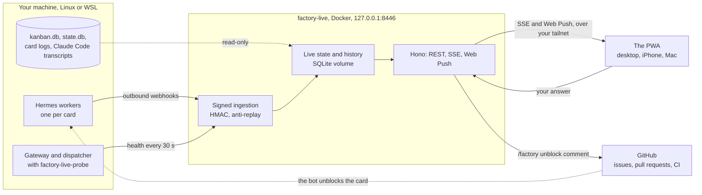

<div align="center">

# factory-live

**Watch your Hermes Agent software factory work in real time, and unblock it from your phone.**

English | [Français](README.fr.md)

[![Site][site-badge]][site]
[![Live demo][demo-badge]][demo]
[![License][license-badge]][license]
[![Built for Hermes Agent][hermes-badge]][hermes]
[![Roadmap][roadmap-badge]][roadmap]

[![CI][ci-badge]][ci]
[![E2E][e2e-badge]][ci]
[![Site build][pages-badge]][pages]
[![Platform][platform-badge]][getting-started]

[![Node][node-badge]][development]
[![TypeScript][typescript-badge]][root-package]
[![React][react-badge]][web-package]
[![Primer React][primer-badge]][web-package]
[![Hono][hono-badge]][server-package]

[![Last commit][commit-badge]][commits]
[![Open issues][issues-badge]][issues]

</div>

<p align="center"></p>

[site-badge]: https://img.shields.io/badge/site-code--my--life.github.io-000000?style=flat
[site]: https://code-my-life.github.io/factory-live/
[demo-badge]: https://img.shields.io/badge/demo-try%20it%20in%20your%20browser-2ea44f?style=flat
[demo]: https://code-my-life.github.io/factory-live/demo/
[license-badge]: https://img.shields.io/badge/license-MIT-blue?style=flat
[license]: LICENSE
[hermes-badge]: https://img.shields.io/badge/built%20for-Hermes%20Agent-1f6feb?style=flat
[hermes]: https://github.com/NousResearch/hermes-agent
[roadmap-badge]: https://img.shields.io/badge/roadmap-on%20the%20site-555555?style=flat
[roadmap]: https://code-my-life.github.io/factory-live/#roadmap
[ci-badge]: https://img.shields.io/github/actions/workflow/status/code-my-life/factory-live/ci.yml?branch=main&label=CI&style=flat
[ci]: https://github.com/code-my-life/factory-live/actions/workflows/ci.yml
[e2e-badge]: https://img.shields.io/badge/e2e-Playwright%2C%20Chromium%20%7C%20WebKit-45ba4b?style=flat
[pages-badge]: https://img.shields.io/github/actions/workflow/status/code-my-life/factory-live/pages.yml?branch=main&label=site&style=flat
[pages]: https://github.com/code-my-life/factory-live/actions/workflows/pages.yml
[platform-badge]: https://img.shields.io/badge/runs%20on-Docker%20%7C%20Linux%20%7C%20WSL-2496ed?style=flat
[getting-started]: #getting-started
[node-badge]: https://img.shields.io/badge/node-%E2%89%A5%2024.15-339933?style=flat
[development]: #development
[typescript-badge]: https://img.shields.io/github/package-json/dependency-version/code-my-life/factory-live/dev/typescript?style=flat
[root-package]: package.json
[react-badge]: https://img.shields.io/github/package-json/dependency-version/code-my-life/factory-live/react?filename=apps%2Fweb%2Fpackage.json&style=flat
[primer-badge]: https://img.shields.io/github/package-json/dependency-version/code-my-life/factory-live/@primer/react?filename=apps%2Fweb%2Fpackage.json&style=flat
[web-package]: apps/web/package.json
[hono-badge]: https://img.shields.io/github/package-json/dependency-version/code-my-life/factory-live/hono?filename=apps%2Fserver%2Fpackage.json&style=flat
[server-package]: apps/server/package.json
[commit-badge]: https://img.shields.io/github/last-commit/code-my-life/factory-live?style=flat
[commits]: https://github.com/code-my-life/factory-live/commits/main
[issues-badge]: https://img.shields.io/github/issues/code-my-life/factory-live?style=flat
[issues]: https://github.com/code-my-life/factory-live/issues

factory-live is the window on an autonomous software factory built on [Hermes Agent](https://github.com/NousResearch/hermes-agent). Hermes agents take GitHub issues labelled `factory` and move them card by card along a factory line: brief, implementation, gate, release. factory-live shows that line live: which issue is at which station, which agent holds it, which model really answered, what it is doing this second, and what waits for your decision. When an agent is stuck, you answer from the app, at your desk or on your iPhone, and the card restarts.

It runs next to the factory, in one Docker container on the same machine, and reaches your other devices through your tailnet. Everything it shows comes from Hermes itself: its native signed webhooks for the live part, its own databases, read-only, for the rest. Nothing is written for it.

The interface is in French; the code is in English. The design follows [Primer](https://primer.style), the design system of GitHub. The [live demo](https://code-my-life.github.io/factory-live/demo/) replays an afternoon of the factory in your browser, without a server.

## What it is, and who it is for

factory-live is made for a developer who runs a factory of AI agents and does not want to follow it through a terminal, a dashboard, a chat bot and ten GitHub tabs. It answers three questions at a glance: where is each issue, is anything stuck, and what does it cost. It watches the factory and never drives it: its one write is the comment you ask for.

It was built for the factory of Code My Life, which develops its own tools, factory-live included. If you run Hermes Agent with a kanban board fed by GitHub issues, it should fit your factory with a few settings (see [Configuration](#configuration)).

## What you see

- **The factory line.** Six stations: Intake, Brief, Implementation, Gate, Release, Done. A box per issue with its state (running, waiting for you, blocked, queued), the agent that holds it and what it does right now; the line flows toward the stations at work and a box glides when its issue moves on. Below, what each agent is doing and the live activity, one entry per tool call, model reply or kanban event.
- **An issue and its card graph.** The cards of the issue (brief, implementation, release) drawn as the same line, the runs of each card with the model actually served, the full transcript (Hermes session, Claude Code or OpenCode lane, raw terminal log), the pull request and its CI, tokens and cost.
- **Interventions and unblocking.** The whole question of the agent, and a reply box. Your answer is posted on the issue as `/factory unblock <answer>` under your GitHub account; the bot of the factory reacts, the card restarts, and the app follows each step. A card held for another reason comes with the exact commands to copy. Blockers that wait for you also reach the iPhone as a notification, with a badge on the app icon.
- **Agents and models.** Each agent with its role, its model chain in fallback order, its effort, skills and plugins, the refusals of its guards over 7 days, its gate pass rate and median run time, and any drift between the configuration in service and the one in the repository.
- **Health.** Gateway, dispatcher, pause switch, dashboard, model providers (freellmapi, NVIDIA, llama.cpp and its VRAM, Claude Code), MCP servers, GitHub API and webhooks, cron jobs, and the sources of factory-live itself.
- **Costs and quotas.** Tokens, calls and 429 responses per day, per model and per agent, and the estimated cost of Claude runs, over 24 hours, 7 or 30 days.
- **History and stats.** Issues done, median time from label to merge, blockers, your median response time, time per station, first-pass rate at the gate for each harness and model, and the last issues done with their version.

The header always tells the state of the link: live, connecting, offline with the age of the last state received, factory paused, or silent factory.

## How it works



- **Native outbound webhooks, signed.** The `hooks.outbound` setting of Hermes Agent posts each event (tool calls, model replies, kanban events, sessions, skills, subagents) to `/api/ingest/hermes`, signed with HMAC-SHA256 and a shared secret. Hermes sends them from a bounded queue in a daemon thread: an agent is never slowed down, and nothing is written to disk for factory-live. The hooks that carry whole conversations are not subscribed.
- **A health probe.** The `factory-live-probe` plugin runs in the gateway, checks the services every 30 seconds and posts a signed report to `/api/ingest/health`. After 90 seconds without a report, the probe is marked silent.
- **The kanban and the sessions, read-only.** `kanban.db` (watched with `PRAGMA data_version` every 300 ms), the `state.db` of each agent, the card logs and the Claude Code transcripts are opened read-only, with short queries; a lint rule forbids any write in the Hermes adapters. After a restart, factory-live catches up from them. The database of OpenCode holds OAuth tokens: it is never mounted.
- **One stream for every screen.** The server keeps the live state and sends each change over Server-Sent Events. A `ping` after 15 seconds of silence keeps the link honest; a stream silent for 45 seconds is restarted, and the app says when it is offline.
- **A progressive web app.** Installable on the iPhone home screen, on Windows and on the Mac; a service worker keeps the shell available offline, and the app opens on the last state received, kept on the device. The API never goes through the cache.
- **Push.** Web Push with VAPID keys generated on first start, only for the blockers that wait for you. The contact sent to push services is the repository address, never an e-mail.
- **Unblocking.** A dedicated GitHub App, created in one click from factory-live, reads issues, pull requests and CI with its installation token; the comment is posted with your user token, so the bot of the factory takes it as yours.

The code follows a clean architecture checked in CI: pure rules in `packages/domain`, zod contracts in `packages/contracts`, use cases behind ports in `apps/server/src/application`, adapters and HTTP around them, and the PWA in `apps/web`. Details, in French: [docs/ARCHITECTURE.md](docs/ARCHITECTURE.md) and [docs/decisions/](docs/decisions/).

If factory-live stops, the factory does not notice: deliveries fail without blocking any agent, and factory-live catches up from the databases when it restarts.

## Getting started

You need Linux or WSL with Docker, Hermes Agent with a kanban board, Tailscale for your phone and your Mac, and a GitHub account.

### 1. On the Hermes side

Each agent lists factory-live in its outbound hooks, with the events it should send:

```yaml
hooks:
  outbound:
    - name: factory-live
      url: http://127.0.0.1:8446/api/ingest/hermes
      secret_env: FACTORY_LIVE_HOOK_SECRET
      timeout: 2
      events: [pre_tool_call, post_tool_call, post_api_request, api_request_error, on_session_end]
```

The secret is a random value in `~/.hermes/.env` (`FACTORY_LIVE_HOOK_SECRET`), copied to `~/.config/factory-live/hook-secret` with mode 600. The `factory-live-probe` plugin runs in the gateway. In the factory of Code My Life, its installer does these three steps.

### 2. The container

```bash
cp docker/.env.example docker/.env      # then set your values, see Configuration
docker compose -f docker/compose.yaml up -d --build
docker ps --filter name=factory-live    # healthy
```

The app is then at `http://localhost:8446` on this machine.

### 3. Your tailnet

```bash
tailscale serve --bg --https=8446 http://127.0.0.1:8446
```

Your phone and your Mac reach the app at `https://<machine>.<tailnet>.ts.net:8446`. Tailnet only, never Funnel.

### 4. Your devices

| Device       | Install                                                                                               | Notifications                                                                   |
| ------------ | ----------------------------------------------------------------------------------------------------- | ------------------------------------------------------------------------------- |
| iPhone, iPad | The tailnet address in Safari, Share, Add to Home Screen, then open factory-live from the home screen | In the settings of the app, "Activer les notifications", then "Envoyer un test" |
| Windows      | `http://localhost:8446` in Edge or Chrome, then the install icon in the address bar                   | The same; Windows must allow notifications from Edge or Chrome                  |
| Mac          | The tailnet address in Safari (File, Add to Dock) or Chrome                                           | The same                                                                        |

On the iPhone, notifications only reach the app installed on the home screen, as iOS requires.

### 5. GitHub

Open `http://localhost:8446/api/github/setup` and confirm on GitHub: factory-live creates a private GitHub App, without webhook, that you install on your repositories. Then, in the settings of the app, "Se connecter à GitHub": your answers are posted under your account. Until then, a fine-grained token in `~/.config/factory-live/github-token` serves as a fallback.

### Configuration

The variables of `docker/compose.yaml`, set in `docker/.env`:

| Variable           | Role                                                                                  |
| ------------------ | ------------------------------------------------------------------------------------- |
| `PUBLIC_ORIGINS`   | Addresses of the app: `http://localhost:8446,https://<machine>.<tailnet>.ts.net:8446` |
| `TAILSCALE_LOGINS` | Tailscale logins allowed to write from another device, for example `you@github`       |
| `HERMES_BOARD`     | The kanban board of the factory (`factory`)                                           |
| `GITHUB_OWNER`     | The GitHub organization or account of the factory                                     |
| `FACTORY_REPO`     | The repository of the factory, read for its configuration (drift)                     |
| `DASHBOARD_URL`    | The address of the Hermes dashboard, linked from the app                              |
| `LOG_LEVEL`        | `info` by default                                                                     |

The defaults target the factory of Code My Life; the GitHub login allowed to unblock is set in `apps/server/src/config.ts`. Operations, mounts, secrets and troubleshooting, in French: [docs/RUNBOOK.md](docs/RUNBOOK.md).

## Development

Node.js 24.15 or later.

```bash
npm ci
npm run dev:web       # the app on the demo data, http://127.0.0.1:5173
npm run dev:server    # the server on your ~/.hermes, read-only, port 8446
npm run verify        # format, lint (ESLint, Stylelint with the rules of Primer), types, text, architecture, tests, build
npm run e2e           # Playwright: the demo on desktop and iPhone, the live app against a fake API
```

- **Demo mode.** `VITE_DATA_SOURCE=demo`, the default for development and end-to-end tests, replays a realistic factory scenario without a server (`apps/web/src/demo/`); `live` connects the app to the API. The site publishes the same demo.
- **End-to-end tests.** Chromium locally; WebKit (Safari, iPhone) and the reference captures run in the official Playwright image, as in CI. The command is in [docs/RUNBOOK.md](docs/RUNBOOK.md).
- **The site.** `npm run site:build` builds the pages and the demo into `site/dist`, `npm run site:preview` serves them at `http://127.0.0.1:4195/factory-live/`, `npm run site:test` checks them, and `npm run site:captures` remakes the screenshots.
- **Rules.** Test first, one word per concept on screen, Primer components and tokens, no write to Hermes: [AGENTS.md](AGENTS.md), in French.

CI runs `npm run verify` on Node 24 and 26, builds and starts the Docker image, and runs the end-to-end tests in Chromium and WebKit. The site has its own workflow, which builds and tests it on every pull request and deploys it from `main`.

## Security

- **Read-only.** The Hermes databases are opened read-only and never written; the OpenCode database and its tokens are never mounted.
- **Signed input.** Webhooks and probe reports are signed with HMAC-SHA256 and checked against a replay window: an unsigned or out-of-window delivery is refused, a duplicate is never applied twice.
- **One write.** The `/factory unblock` comment, posted under your GitHub account, only from this machine or from the allowed Tailscale login, with a same-origin check and at most 30 writes a minute.
- **Exposure.** The container listens on `127.0.0.1:8446`; other devices reach it through your tailnet with `tailscale serve`, never Funnel. No password: the tailnet is the boundary.
- **Container.** User 1000:1000, read-only root filesystem, no capability.
- **Secrets.** The keys of the GitHub App and your tokens live in the database of the data volume (mode 600), never in the repository, the logs or the API.

Please report a vulnerability privately, through a GitHub security advisory, rather than in a public issue.

## License

[MIT](LICENSE).
